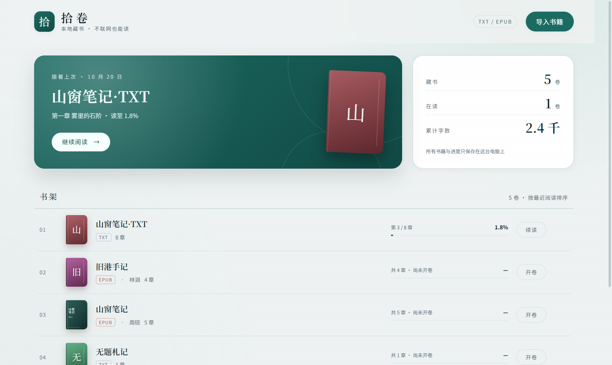
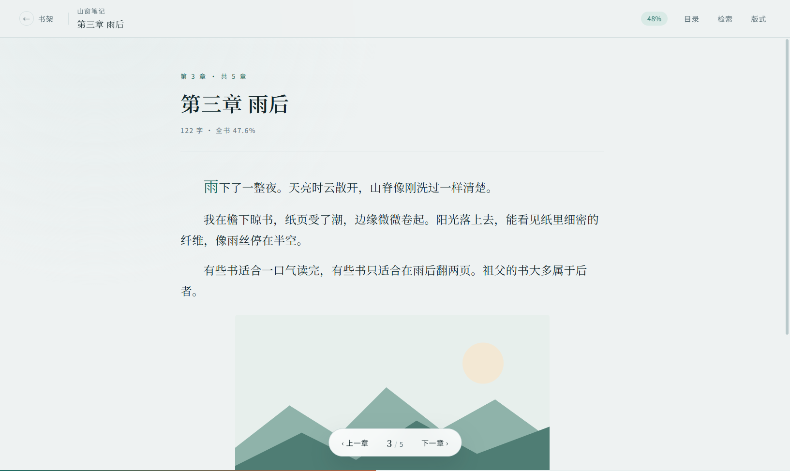
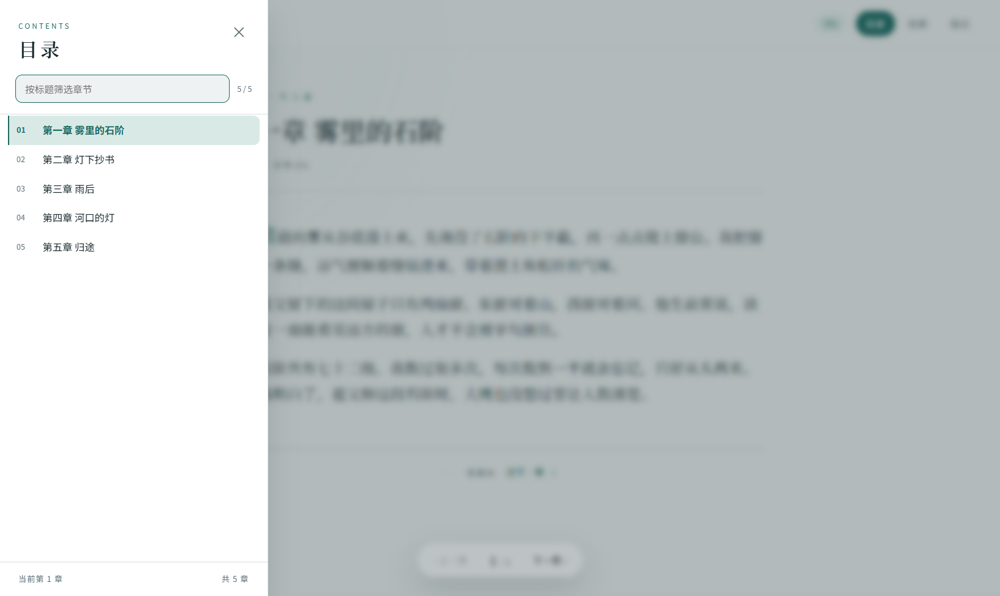

# 拾卷 · ShiJuan

本地优先的桌面电子书阅读器。支持 **TXT / EPUB**，用目录切换章节，进度、封面、版式全部留在本机。

> 版本：v0.2（迭代 2）｜平台：Windows 优先，兼容 macOS / Linux｜框架：Electron + React + TypeScript

## 功能

- **TXT 导入**：自动识别 UTF-8 / BOM / UTF-16 / GBK / GB18030，卷章两级切分，无标题自动退化为单章。
- **EPUB 导入**：EPUB 3（nav）与 EPUB 2（NCX）目录、spine 切章、正文图片、封面、DRM 与损坏文件报错。
- **目录**：左侧滑出，层级缩进，标题筛选，当前章高亮，点击直接跳章。
- **阅读**：章节内滚动、上一章 / 下一章、全书百分比、章末续读。
- **进度**：按章节字符加权，滚动 320ms 防抖落盘，切章立即保存，重启回到原处。
- **版式**：月白 / 茶烟 / 玄墨三底色，字号、行距、版心、宋体 / 黑体可调。
- **检索**：`Ctrl/Cmd + F` 全书检索，命中跳转并高亮。
- **书架**：续读卡、书脊式列表、真实封面、格式徽标、拖动导入、二次确认删除。

## 快速开始

```bash
npm install
npm run samples     # 生成 samples/ 下的 TXT 与 EPUB 样例
npm run dev         # 开发模式
```

生产构建与验证：

```bash
npm run typecheck
npm test
npm run build
npm run smoke       # 启动真实窗口跑 E2E，并写入 docs/screenshots/
npm run dist        # 打包安装包
```

## 打包产物

`npm run dist` 先构建 `out/`，再由 electron-builder 按 `electron-builder.yml` 输出到 `release/`：

| 文件 | 说明 |
| --- | --- |
| `release/拾卷 Setup 0.2.0.exe` | NSIS 安装包，约 108 MB，安装后创建桌面与开始菜单快捷方式 |
| `release/拾卷 0.2.0.exe` | 单文件免安装版，约 108 MB，双击即用 |
| `release/win-unpacked/` | 解包目录，含 `拾卷.exe`，排查启动问题用 |

国内网络建议先设镜像，否则会在下载 NSIS 时卡住：

```powershell
$env:ELECTRON_BUILDER_BINARIES_MIRROR="https://registry.npmmirror.com/-/binary/electron-builder-binaries/"
$env:ELECTRON_MIRROR="https://registry.npmmirror.com/-/binary/electron/"
npm run dist
```

`release/` 已在 `.gitignore` 中，产物不入库；需要分发时手动拷出即可。当前未配置应用图标，任务栏显示 Electron 默认图标。

## 目录

```
PRD.md              产品需求（范围、功能、验收）
TECH_DESIGN.md      技术设计（架构、数据、EPUB 链路、安全）
AGENTS.md           协作约定与质量门禁
ITERATION.md        迭代记录（v0.1 → v0.2、缺陷与修复）
docs/screenshots/   迭代截图
samples/            示例书籍（TXT / EPUB2 / EPUB3）
src/                源码（main / preload / renderer / shared）
tests/              单元测试与 E2E 冒烟
scripts/            示例书生成脚本
```

## 数据位置

所有数据只写在本机 `app.getPath('userData')`：

```
store/shelf.json         书架索引
store/positions.json     阅读进度
store/prefs.json         版式设置
volumes/<bookId>/        单本书的原文件副本、逐章正文、EPUB 图片
```

删除书籍只清理上述副本与索引，**不会动你导入的原始文件**。E2E 通过 `SHIJUAN_USER_DATA` 使用临时目录，不污染真实书架。

## 截图

| 书架（v0.2） | EPUB 阅读（v0.2） |
| --- | --- |
|  |  |

| 目录切换 | 夜间底色 |
| --- | --- |
|  |  |

迭代 1（TXT）的截图见 `docs/screenshots/v01-*.png`。

## 已知限制

- 目录项与章节一一对应：卷标题与首章同页时，卷标题会被更具体的章名取代。
- 不加载 EPUB 内嵌字体，正文使用系统字族。
- 不支持 PDF / MOBI / AZW3，不含书签、批注、云同步。

更多细节见 `TECH_DESIGN.md` 第 12 节。
